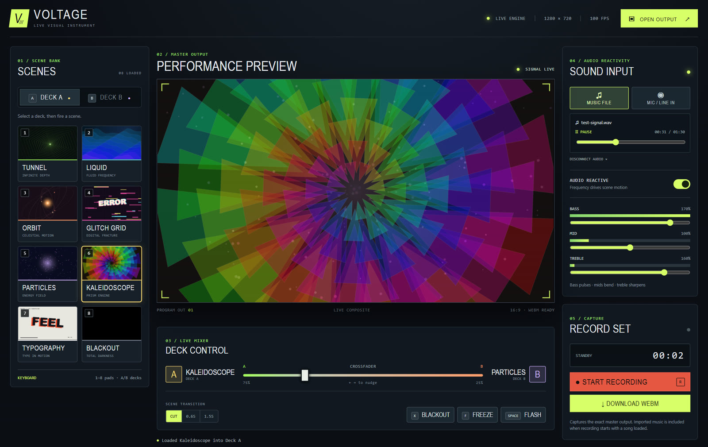
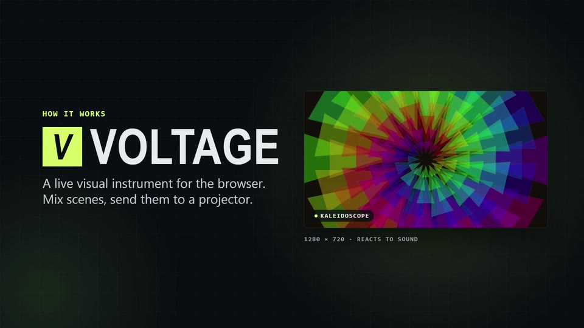
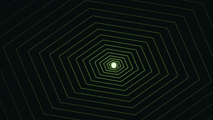
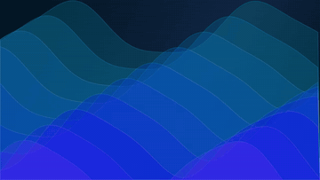
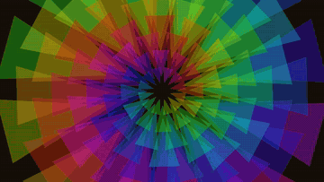
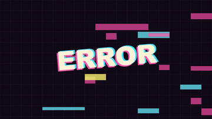
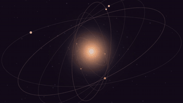
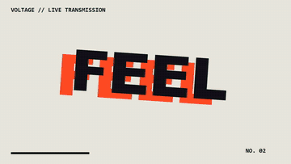

# VOLTAGE

A live visual instrument in the browser. Load eight audio-reactive scenes into two decks, mix them with a
crossfader, hit blackout, freeze or flash, and send the picture to a projector in its own window. You can record the
set as a WebM video.

**Everything runs on your computer. No account, no API key, nothing is uploaded.**

VOLTAGE is an early version (0.1). It passes its automated check in Chrome on Windows 11, but it has not yet been
tried on many projectors, audio interfaces or long shows.



<!-- videos:start -->
## See it in action

<p align="center"><a href="docs/videos/tutorial.mp4"></a><br><b>▶ <a href="docs/videos/tutorial.mp4">How it works</a></b> (0:59, with captions)</p>

**Recorded with VOLTAGE's own recorder: every scene is drawn by the app, moved by a generated test signal**

<table><tr>
<td width="33%" align="center"><a href="docs/videos/examples/tunnel.mp4"></a><br><a href="docs/videos/examples/tunnel.mp4">Tunnel</a></td>
<td width="33%" align="center"><a href="docs/videos/examples/liquid.mp4"></a><br><a href="docs/videos/examples/liquid.mp4">Liquid</a></td>
<td width="33%" align="center"><a href="docs/videos/examples/kaleidoscope.mp4"></a><br><a href="docs/videos/examples/kaleidoscope.mp4">Kaleidoscope</a></td>
</tr><tr>
<td width="33%" align="center"><a href="docs/videos/examples/glitch-grid.mp4"></a><br><a href="docs/videos/examples/glitch-grid.mp4">Glitch Grid</a></td>
<td width="33%" align="center"><a href="docs/videos/examples/orbit-particles-crossfade.mp4"></a><br><a href="docs/videos/examples/orbit-particles-crossfade.mp4">Orbit → Particles, crossfader</a></td>
<td width="33%" align="center"><a href="docs/videos/examples/live-set-fades.mp4"></a><br><a href="docs/videos/examples/live-set-fades.mp4">Scene changes, 0.6 s fades</a></td>
</tr></table>

Click any picture to play the video. Example sources: none from outside. VOLTAGE draws every scene itself, and the sound that moves them is a generated test signal (pulsed tones made in code, no music). The videos have no sound.
<!-- videos:end -->

## Install

You need:
- Windows 10 or 11 (it is built and tested on Windows 11)
- [Node.js](https://nodejs.org) 20.19+ or 22.12+
- Google Chrome or Microsoft Edge
- Optional: [Python](https://www.python.org/downloads/) with Pillow, only to redraw the icon

```
npm install
npm run dev
```

Then open http://127.0.0.1:5173/ in Chrome or Edge. Leave the terminal open while you play: it is the local server.

Optional: `powershell -ExecutionPolicy Bypass -File "Create Desktop Shortcut.ps1"` puts a **VOLTAGE - Live Visual
Instrument** shortcut on your Desktop. It runs `Open VOLTAGE.ps1`, which starts the local server without a window
(if it isn't running yet) and opens the app in your default browser. That server keeps running in the background after
you close the browser, and the shortcut reuses it next time. To stop it, end the `node.exe` process in Task Manager,
or sign out. Known issue: the launcher can't start the server when the folder's path contains a space (for example
`D:\My Apps\voltage`); use `npm run dev` there, or move the folder to a path without spaces.

## Set up the projector window

1. Click **OPEN OUTPUT** (top right). A second window opens. It shows only the picture, 1280 × 720 (16:9).
2. Drag that window to the projector screen (in Windows, set the displays to **Extend** with Win+P) and click
   **ENTER FULLSCREEN** in it. In full screen the button only shows while the mouse is over that screen, so move the
   mouse back to your own screen. Esc leaves full screen.
3. If no window opens, the browser blocked the pop-up. Allow pop-ups for `127.0.0.1`, then click **OPEN OUTPUT**
   again.

The output shows exactly the preview in the middle of the controller, including blackout and flash. It has no sound.
On a screen that is not 16:9 the picture keeps its shape, with black bars.

Keep the controller window open and not minimized. The output only shows what the controller draws, and browsers stop
drawing in minimized (or fully covered) windows, so the output would freeze. If you close or reload the controller,
the output stops too: click **OPEN OUTPUT** again. When you close the output window, the button goes back to
**OPEN OUTPUT**.

## Play

The controller has three columns: the scenes on the left, the preview and the mixer in the middle, sound and
recording on the right.

### Scenes

| Key | Scene | What you see |
|---|---|---|
| 1 | Tunnel | Green hexagon rings rushing toward you |
| 2 | Liquid | Layered blue waves |
| 3 | Orbit | Planets on tilted orbits around a glowing sun |
| 4 | Glitch Grid | A pink grid with flickering bars and a colour-split "ERROR" |
| 5 | Particles | Violet particles streaming out from the centre |
| 6 | Kaleidoscope | Turning rings of coloured triangles |
| 7 | Typography | Big words (MOVE, FEEL, LIVE, NOW) on a paper-white background |
| 8 | Blackout | Plain black: an empty deck |

All scenes move on their own. With sound connected, bass makes them pulse and grow, mids bend and turn them, and
treble sharpens lines and speeds up the flicker.

### Decks and mixer

- There are two decks, **A** and **B**. Pick a deck (its button, or the `A` / `B` key), then click a scene pad (or
  press `1` to `8`) to load that scene into it. The highlighted pad is the scene in the selected deck. At the start,
  deck A has Tunnel and deck B has Orbit.
- **Crossfader**: all the way left shows only deck A, all the way right only deck B. In between, deck B is laid over
  deck A at that strength. `←` / `→` move it 5 % at a time.
- **Scene transition**: **CUT**, **0.6S** or **1.5S**. When you load a new scene into a deck, it fades in over the old
  one in that time.
- **BLACKOUT** (`X`): the output goes black until you press it again.
- **FREEZE** (`F`): holds the current frame. Blackout and flash still work on top of it.
- **FLASH** (hold `Space`, or hold the button): full white while you hold it.
- The top bar shows the frame rate. The line under the mixer says what just happened.

### Sound

- **MUSIC FILE**: pick an audio file your browser can play (MP3, WAV, M4A, OGG, ...). It plays through your speakers,
  with play / pause and a position bar.
- **MIC / LINE IN**: listens to your default audio input. The browser asks for permission the first time. Then a list
  lets you pick another input. This input only drives the visuals: it is not played back and not recorded.
- **DISCONNECT AUDIO** stops either one.
- **AUDIO REACTIVE** turns the reaction to sound off and on.
- The three meters show **bass** (30 to 180 Hz), **mid** (180 to 2,200 Hz) and **treble** (2.2 to 12 kHz). The slider
  under each one sets its sensitivity, from 0 to 200 %.

### Record

- **START RECORDING** (or `R`) records the output: 1280 × 720, 30 frames a second, a VP9 (or VP8) WebM at about
  6 Mbit/s. If a music file is loaded when you start, its sound is recorded too. The microphone never is.
- Stop with the same button (or `R`), then click **DOWNLOAD WEBM**. The browser saves `voltage-set-<date>.webm` in its
  downloads folder. VOLTAGE saves nothing anywhere else.
- Until you download it, the recording is only in the browser's memory (roughly 40 MB a minute). It is lost if you
  close or reload the controller.
- Browsers write these WebM files without their length, so some players show no duration or can't seek in them.
  `ffmpeg -i voltage-set.webm -c copy fixed.webm` fixes that, if you have [ffmpeg](https://ffmpeg.org/download.html).

### Keys

| Key | Does |
|---|---|
| `1` to `8` | Load a scene into the selected deck |
| `A` / `B` | Select deck A or B |
| `←` / `→` | Move the crossfader |
| `Space` (hold) | Flash |
| `X` | Blackout on / off |
| `F` | Freeze on / off |
| `R` | Start / stop recording |

The keys do nothing while a slider, a list or a text field has the keyboard focus, or while Ctrl or Alt is held.
Known issue: after you drag a slider with the mouse, it keeps the focus, so the keys don't work (and `←` / `→` move
that slider) until you click somewhere else in the window.

### Saved settings

The deck scenes, the crossfader, the transition time, the audio-reactive switch and the three sensitivities are saved
in the browser (local storage) and come back the next time you open VOLTAGE in the same browser.

## What's where

```
voltage/
├─ index.html, vite.config.ts, tsconfig.json   the Vite + React + TypeScript setup
├─ src/
│  ├─ main.tsx       start-up
│  ├─ App.tsx        the controller: panels, keys, the output window, recording
│  ├─ engine.ts      the render loop: two 1280×720 decks, scene fades, crossfader, blackout, freeze, flash,
│  │                 and the 30 fps stream that feeds the output window and the recorder
│  ├─ scenes.ts      the eight scenes (Canvas 2D drawing) and how they react to bass, mids and treble
│  ├─ audio.ts       music file and microphone input, the frequency analysis, the song track for recordings
│  └─ styles.css     the look
├─ assets/           the app icon (voltage.ico, voltage-icon.png)
├─ scripts/
│  ├─ smoke.mjs      the end-to-end check in headless Chrome or Edge
│  └─ make_icon.py   draws the icon (python scripts/make_icon.py; needs Pillow)
├─ Open VOLTAGE.ps1              launcher: starts the local server if needed and opens the app
└─ Create Desktop Shortcut.ps1   puts a shortcut to the launcher on your Desktop
```

| Command | What it does |
|---|---|
| `npm run dev` | Local server with hot reload on http://127.0.0.1:5173 |
| `npm run build` | Type-check and build into `dist/` |
| `npm run preview` | Serve the built `dist/` on http://127.0.0.1:4173 |
| `npm run smoke` | End-to-end check (start `npm run dev` first) |

## Tests

```
npm run build
npm run dev          (keep it running; in a second terminal:)
npm run smoke
```

- `npm run build`: the TypeScript check and the production build.
- `npm run smoke`: in headless Chrome (or Edge) on http://127.0.0.1:5173, it checks the eight scene pads, loading
  scenes into both decks with the keys, that the crossfader changes the picture, that the output window opens with a
  1280×720 picture and goes full screen, and that a test tone (made in memory) moves the meters. Then it records about
  30 seconds while switching scenes and using blackout, freeze and flash, downloads the WebM, checks its size and that
  it plays (1280 pixels wide), and fails on any page error. It saves `artifacts/acceptance.webm` and
  `artifacts/interface.png`. `npm run smoke -- --short` records 3 seconds instead of 30. Set `VOLTAGE_BROWSER` to a
  browser's `.exe` if yours isn't found.

## Credits

- Built with [React](https://react.dev) (MIT) and [Vite](https://vite.dev) (MIT), in TypeScript (Apache-2.0). The
  smoke test uses [Playwright](https://playwright.dev) (Apache-2.0).
- The scenes and the icon are drawn in code, and the interface uses fonts that come with Windows. No third-party
  images, fonts or sounds are included.
- Footage in the tutorial and examples: recorded from VOLTAGE itself. The sound that moves the scenes is a
  generated test signal (pulsed tones made in code, no music), and the videos have no sound.

## Licence

MIT, see [LICENSE](LICENSE).
